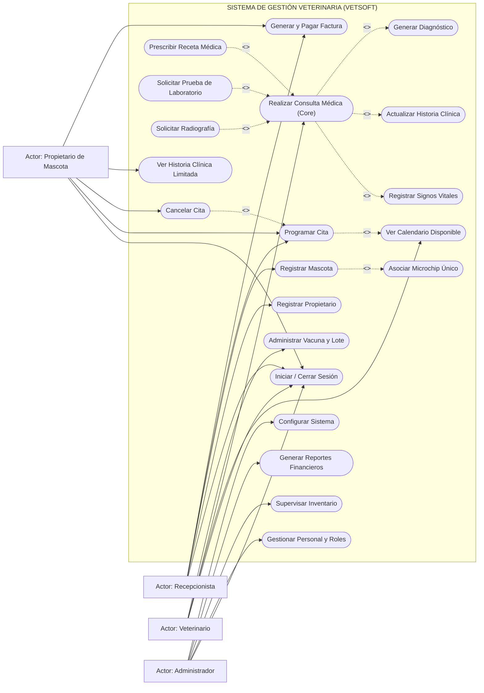
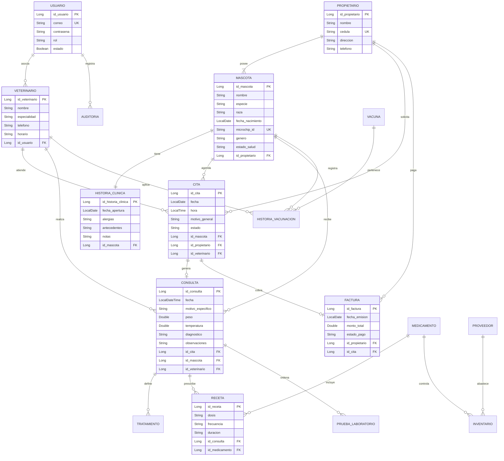
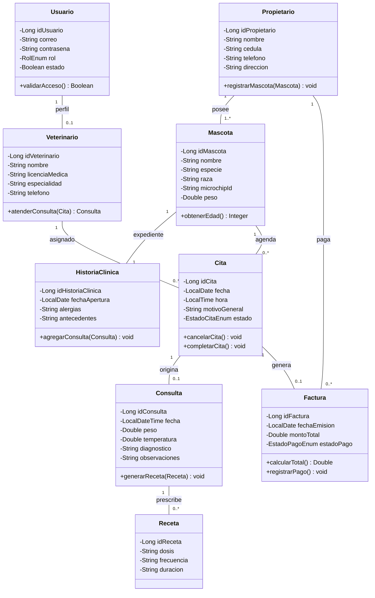

# Documentación de Análisis y Diseño: Sistema de Gestión Veterinaria (VetSoft)

**Autor:** Equipo de Desarrollo Backend & Arquitectura  
**Tecnología:** Spring Boot, PostgreSQL, Spring Security, JPA / Hibernate  
**Fecha:** 13 de noviembre de 2026  

---

## Índice de Contenidos
1. Introducción y Propósito
2. Alcance del Proyecto
3. Problema, Usuarios y Objetivos
4. Requerimientos Funcionales (IEEE 830)
5. Requerimientos No Funcionales (RNF)
6. Casos de Uso y Diagrama de Casos de Uso
7. Modelo de Datos y Diagrama Entidad-Relación (DER)
8. Diagrama de Clases
9. Arquitectura del Sistema y Prototipo de Pantallas
10. Plan de Pruebas Inicial
11. Referencias

---

## 1. Introducción y Propósito

El presente documento especifica los requerimientos funcionales y no funcionales del Sistema de Gestión Veterinaria (**VetSoft**). El propósito del sistema es automatizar los procesos clínicos y administrativos de una clínica veterinaria, permitiendo gestionar el registro de propietarios, mascotas, historiales clínicos, citas, consultas médicas, vacunación, recetas, pruebas de laboratorio, inventario y facturación bajo una arquitectura web robusta y segura.

---

## 2. Alcance del Proyecto

El producto mínimo viable (MVP) comprende el desarrollo integral de las siguientes funcionalidades:
* Autenticación y control de acceso basado en roles (Administrador, Veterinario, Recepcionista y Propietario).
* Gestión de clientes (Propietarios) y pacientes (Mascotas con microchip único).
* Agendamiento y control de citas veterinarias con validación de disponibilidad y estados en tiempo real.
* Atención de consultas médicas, registro de signos vitales, diagnósticos y recetas digitales.
* Control preventivo de vacunas con alertas de refuerzo y solicitud de exámenes de laboratorio.
* Módulos administrativos para control de inventarios de medicamentos, gestión de personal y facturación.

### Tabla 1: Datos del Proyecto
| Campo | Detalle |
| :--- | :--- |
| **Proyecto** | Sistema de Gestión Veterinaria (VetSoft) |
| **Modalidad** | Desarrollo Web Full Stack, 4 Sprints |
| **Tecnología** | Backend: Java + Spring Boot / Base de Datos: PostgreSQL / Seguridad: Spring Security + JWT |
| **Metodología** | Scrum (Sprints semanales con entrega incremental) |

---

## 3. Problema, Usuarios y Objetivos

### Problema
Las clínicas veterinarias suelen llevar registros en papel o en hojas de cálculo fragmentadas, lo que dificulta el seguimiento rápido del historial médico de los pacientes, provoca cruces de horarios en la asignación de citas, impide un control exacto del stock de medicamentos o vacunas y retrasa la facturación transparente hacia los propietarios de las mascotas.

### Tabla 2: Usuarios del Sistema y Historias de Usuario (Backlog)
| Rol de Usuario | Qué necesita en el sistema | Historias Asociadas |
| :--- | :--- | :--- |
| **Administrador** | Gestionar personal interno, configurar parámetros del sistema, supervisar inventarios y generar reportes financieros. | HU-VET-01, HU-VET-12, HU-VET-13, HU-VET-14 |
| **Veterinario** | Atender consultas médicas, registrar signos vitales y diagnósticos, prescribir recetas, aplicar vacunas, solicitar pruebas de laboratorio y actualizar historias clínicas. | HU-VET-06, HU-VET-07, HU-VET-08, HU-VET-09, HU-VET-10, HU-VET-11 |
| **Recepcionista** | Registrar nuevos propietarios y mascotas, programar o cancelar citas y gestionar la facturación de servicios. | HU-VET-03, HU-VET-04, HU-VET-05, HU-VET-06, HU-VET-13 |
| **Propietario de Mascota** | Consultar el historial médico resumido de sus mascotas, verificar citas programadas, actualizar sus datos y pagar facturas. | HU-VET-02, HU-VET-05, HU-VET-08, HU-VET-13 |

### Objetivo General
Desarrollar un sistema de información web utilizando Spring Boot y PostgreSQL que centralice la operación clínica y administrativa de la veterinaria, garantizando la integridad referencial, la seguridad por roles y la disponibilidad de la información.

### Objetivos Específicos
1. Diseñar la arquitectura del sistema, el modelo relacional en PostgreSQL y la especificación de requisitos bajo el estándar IEEE 830 (Semana 1).
2. Implementar el módulo de autenticación JWT, control de roles y el CRUD de propietarios, mascotas y citas (Semana 2).
3. Desarrollar el núcleo clínico: atención de consultas médicas, historias clínicas, recetas, vacunas y pruebas de laboratorio (Semana 3).
4. Integrar el módulo de inventario, facturación, pruebas integrales del sistema y despliegue (Semana 4).

---

## 4. Requerimientos Funcionales (IEEE 830)

El sistema cumple con 14 requerimientos funcionales estructurados bajo la norma IEEE 830:

### VET-RF-01. Registrar un nuevo usuario interno con correo, contraseña y rol
| Campo | Contenido |
| :--- | :--- |
| **Código del requerimiento** | VET-RF-01 |
| **Nombre del requerimiento** | Registrar un nuevo usuario interno con correo, contraseña y rol |
| **Versión / Fecha** | 2.0 — 13/11/2026 |
| **Módulo general** | Seguridad y Usuarios (SEG) |
| **Objetivo** | Permitir al Administrador crear cuentas para el personal de la clínica (Veterinarios, Recepcionistas, Administradores) y clientes en la base de datos PostgreSQL. |
| **Entradas** | `(*)` Nombre completo; `(*)` Correo electrónico (formato válido); `(*)` Contraseña (mínimo 6 caracteres); `(*)` Rol (`ENUM`: `ADMINISTRADOR`, `VETERINARIO`, `RECEPCIONISTA`, `PROPIETARIO`). |
| **Precondiciones** | El Administrador tiene una sesión activa con token válido. Conexión activa con el motor PostgreSQL. |
| **Validaciones y reglas** | **Escenario 1 (Registro exitoso):** El Administrador completa el formulario y pulsa "Registrar". El backend valida que el correo no exista, encripta la clave con `BCryptPasswordEncoder` y guarda el registro en la tabla `usuario` (y `veterinario` si aplica). |
| **Excepciones / Errores** | **Escenario 2 (Correo duplicado):** Muestra *"Este correo electrónico ya está registrado"*.<br>**Escenario 3 (Contraseña corta):** Muestra *"La contraseña debe tener al menos 6 caracteres"*. |
| **Postcondiciones** | Usuario creado en PostgreSQL con estado `activo = true`. |
| **Descripción / Historia** | Implementa el alta de usuarios con encriptación y asignación de rol. Cubre **HU-VET-01**. |
| **RNF Asociados / Prioridad** | VET-RNF-01, VET-RNF-02, VET-RNF-03 — **Prioridad: Alta** |

### VET-RF-02. Iniciar y cerrar sesión (Autenticación JWT)
| Campo | Contenido |
| :--- | :--- |
| **Código del requerimiento** | VET-RF-02 |
| **Nombre del requerimiento** | Iniciar y cerrar sesión |
| **Módulo general** | Seguridad y Usuarios (SEG) |
| **Objetivo** | Permitir que los usuarios accedan a los módulos autorizados según su rol mediante validación de credenciales y emisión de tokens JWT. |
| **Entradas** | `(*)` Correo electrónico; `(*)` Contraseña. |
| **Precondiciones** | El usuario existe en la tabla `usuario` y tiene estado `activo = true`. |
| **Validaciones y reglas** | **Escenario 1 (Login correcto):** El usuario ingresa credenciales válidas. Spring Security autentica los datos, genera un token JWT con el rol incluido y redirige al panel principal correspondiente.<br>**Escenario 2 (Logout):** El usuario pulsa "Cerrar sesión", se limpia el token de sesión y se redirige a `/login`. |
| **Excepciones / Errores** | **Escenario 3 (Credenciales inválidas):** Muestra *"Correo o contraseña incorrectos"*.<br>**Escenario 4 (Usuario inactivo):** Muestra *"La cuenta se encuentra deshabilitada. Contacte al administrador"*. |
| **Postcondiciones** | Sesión activa con token JWT válido o sesión finalizada de forma segura. |
| **Descripción / Historia** | Gestiona el control de acceso seguro al sistema. Cubre **HU-VET-02**. |
| **RNF Asociados / Prioridad** | VET-RNF-01, VET-RNF-02, VET-RNF-04 — **Prioridad: Alta** |

### VET-RF-03. Gestionar propietarios de mascotas: crear, editar y consultar
| Campo | Contenido |
| :--- | :--- |
| **Código del requerimiento** | VET-RF-03 |
| **Nombre del requerimiento** | Gestionar propietarios de mascotas: crear, editar y consultar |
| **Módulo general** | Propietarios y Mascotas (PM) |
| **Objetivo** | Mantener el registro actualizado de los clientes (dueños de mascotas) para asociarles pacientes, citas y facturas. |
| **Entradas** | `(*)` Nombre completo; `(*)` Documento / Cédula (`UNIQUE`); `(*)` Teléfono; `(*)` Dirección; Correo electrónico. |
| **Precondiciones** | Sesión iniciada con rol `RECEPCIONISTA`, `VETERINARIO` o `ADMINISTRADOR`. |
| **Validaciones y reglas** | **Escenario 1 (Creación/Edición):** Se validan los campos obligatorios y que la cédula no esté duplicada. Se ejecuta `INSERT` o `UPDATE` en la tabla `propietario`. |
| **Excepciones / Errores** | **Escenario 2 (Documento duplicado):** Muestra *"Ya existe un propietario registrado con este número de documento"*. |
| **Postcondiciones** | Datos del propietario almacenados y disponibles para vincular mascotas. |
| **Descripción / Historia** | CRUD completo de clientes de la clínica. Cubre **HU-VET-03**. |
| **RNF Asociados / Prioridad** | VET-RNF-02, VET-RNF-03 — **Prioridad: Alta** |

### VET-RF-04. Gestionar mascotas: registrar, asignar dueño y asociar microchip
| Campo | Contenido |
| :--- | :--- |
| **Código del requerimiento** | VET-RF-04 |
| **Nombre del requerimiento** | Gestionar mascotas: registrar, asignar dueño y asociar microchip |
| **Módulo general** | Propietarios y Mascotas (PM) |
| **Objetivo** | Registrar los pacientes animales vinculándolos a su propietario y abriendo automáticamente su expediente clínico base. |
| **Entradas** | `(*)` Nombre de la mascota; `(*)` Especie; `(*)` Raza; Fecha de nacimiento; Género; Peso inicial; Código de Microchip (`UNIQUE`); `(*)` `id_propietario`. |
| **Precondiciones** | El propietario seleccionado debe existir en la base de datos. |
| **Validaciones y reglas** | **Escenario 1 (Registro exitoso):** Al guardar la mascota en la tabla `mascota`, el sistema crea automáticamente su registro único en `historia_clinica` (Relación 1:1). |
| **Excepciones / Errores** | **Escenario 2 (Microchip duplicado):** Muestra *"El código de microchip ingresado ya pertenece a otra mascota"*. |
| **Postcondiciones** | Mascota e historia clínica inicial creadas en PostgreSQL. |
| **Descripción / Historia** | Administración de pacientes animales y vínculo con su dueño. Cubre **HU-VET-04**. |
| **RNF Asociados / Prioridad** | VET-RNF-02, VET-RNF-03 — **Prioridad: Alta** |

### VET-RF-05. Programar, reprogramar y cancelar citas veterinarias
| Campo | Contenido |
| :--- | :--- |
| **Código del requerimiento** | VET-RF-05 |
| **Nombre del requerimiento** | Programar, reprogramar y cancelar citas veterinarias |
| **Módulo general** | Citas y Agenda (CIT) |
| **Objetivo** | Organizar la atención de pacientes asignando fecha, hora y médico veterinario sin cruces de agenda. |
| **Entradas** | `(*)` `id_mascota`; `(*)` `id_propietario`; `(*)` `id_veterinario`; `(*)` Fecha y hora; `(*)` Motivo general; Estado (`PENDIENTE`, `COMPLETADA`, `CANCELADA`). |
| **Precondiciones** | Mascota y veterinario activos en el sistema. |
| **Validaciones y reglas** | **Escenario 1 (Agendamiento):** El sistema verifica en la tabla `cita` que el veterinario no tenga otra cita activa en ese mismo bloque horario y guarda el registro con estado `PENDIENTE`. |
| **Excepciones / Errores** | **Escenario 2 (Horario ocupado):** Muestra *"El veterinario seleccionado ya tiene una cita programada en ese horario"*. |
| **Postcondiciones** | Cita registrada o actualizada en el calendario de la clínica. |
| **Descripción / Historia** | Control de agenda médica y estados de cita. Cubre **HU-VET-05**. |
| **RNF Asociados / Prioridad** | VET-RNF-03, VET-RNF-04 — **Prioridad: Alta** |

### VET-RF-06. Consultar calendario y disponibilidad médica
| Campo | Contenido |
| :--- | :--- |
| **Código del requerimiento** | VET-RF-06 |
| **Nombre del requerimiento** | Consultar calendario y disponibilidad médica |
| **Módulo general** | Citas y Agenda (CIT) |
| **Objetivo** | Visualizar las citas del día o de la semana filtradas por veterinario o estado para agilizar la recepción y atención. |
| **Entradas** | Fecha de consulta; `id_veterinario` (opcional); Estado de cita (opcional). |
| **Precondiciones** | Usuario autenticado en el sistema. |
| **Validaciones y reglas** | **Escenario 1:** Consulta paginada y ordenada cronológicamente desde PostgreSQL. |
| **Excepciones / Errores** | **Escenario 2 (Sin registros):** Muestra *"No hay citas programadas para los filtros seleccionados"*. |
| **Postcondiciones** | Listado de citas visible en pantalla sin modificar datos. |
| **Descripción / Historia** | Visualización de agenda diaria y semanal. Cubre **HU-VET-06**. |
| **RNF Asociados / Prioridad** | VET-RNF-01, VET-RNF-04 — **Prioridad: Media** |

### VET-RF-07. Realizar consulta médica y registrar signos vitales
| Campo | Contenido |
| :--- | :--- |
| **Código del requerimiento** | VET-RF-07 |
| **Nombre del requerimiento** | Realizar consulta médica y registrar signos vitales |
| **Módulo general** | Consultas e Historia Clínica (CLI) |
| **Objetivo** | Permitir al veterinario documentar la evaluación física, signos vitales, diagnóstico y tratamiento durante la atención de la mascota. |
| **Entradas** | `(*)` `id_mascota`; `(*)` `id_veterinario`; `id_cita`; `(*)` Peso (kg); `(*)` Temperatura (°C); `(*)` Motivo específico; `(*)` Diagnóstico; Observaciones. |
| **Precondiciones** | El usuario tiene rol `VETERINARIO`. |
| **Validaciones y reglas** | **Escenario 1:** Se valida que peso y temperatura sean valores positivos coherentes. Al guardar la consulta en la tabla `consulta`, la cita asociada pasa automáticamente a estado `COMPLETADA`. |
| **Excepciones / Errores** | **Escenario 2 (Campos clínicos vacíos):** Muestra *"El diagnóstico y los signos vitales son obligatorios para cerrar la consulta"*. |
| **Postcondiciones** | Consulta registrada y vinculada al expediente de la mascota. |
| **Descripción / Historia** | Registro del acto médico veterinario. Cubre **HU-VET-07**. |
| **RNF Asociados / Prioridad** | VET-RNF-02, VET-RNF-03 — **Prioridad: Alta** |

### VET-RF-08. Consultar y actualizar la historia clínica de la mascota
| Campo | Contenido |
| :--- | :--- |
| **Código del requerimiento** | VET-RF-08 |
| **Nombre del requerimiento** | Consultar y actualizar la historia clínica de la mascota |
| **Módulo general** | Consultas e Historia Clínica (CLI) |
| **Objetivo** | Centralizar todos los antecedentes, alergias, consultas previas, vacunas, recetas y exámenes de una mascota en una vista cronológica única. |
| **Entradas** | `(*)` `id_mascota`; Alergias; Antecedentes médicos; Notas generales. |
| **Precondiciones** | La mascota está registrada en el sistema. |
| **Validaciones y reglas** | **Escenario 1:** El veterinario consulta o edita las alergias y antecedentes en `historia_clinica` y visualiza la lista completa de consultas históricas. El propietario solo tiene acceso de lectura resumida. |
| **Excepciones / Errores** | **Escenario 2 (Acceso no autorizado):** Si un propietario intenta editar, el sistema bloquea la acción con código HTTP 403. |
| **Postcondiciones** | Expediente clínico actualizado en PostgreSQL. |
| **Descripción / Historia** | Gestión integral del expediente único por mascota. Cubre **HU-VET-08**. |
| **RNF Asociados / Prioridad** | VET-RNF-02, VET-RNF-03 — **Prioridad: Alta** |

### VET-RF-09. Prescribir medicamentos y emitir receta médica
| Campo | Contenido |
| :--- | :--- |
| **Código del requerimiento** | VET-RF-09 |
| **Nombre del requerimiento** | Prescribir medicamentos y emitir receta médica |
| **Módulo general** | Consultas e Historia Clínica (CLI) |
| **Objetivo** | Emitir la fórmula médica detallada asociada a una consulta y descontar opcionalmente del inventario si se entrega en clínica. |
| **Entradas** | `(*)` `id_consulta`; `(*)` `id_medicamento`; `(*)` Dosis; `(*)` Frecuencia; `(*)` Duración; Observaciones. |
| **Precondiciones** | Consulta médica previamente creada. |
| **Validaciones y reglas** | **Escenario 1:** Se guarda el detalle en la tabla `receta` y `tratamiento`, asociando los medicamentos del catálogo. |
| **Excepciones / Errores** | **Escenario 2 (Falta de indicaciones):** Muestra *"Debe especificar dosis, frecuencia y duración del medicamento"*. |
| **Postcondiciones** | Receta médica almacenada y disponible para impresión o consulta del propietario. |
| **Descripción / Historia** | Prescripción farmacológica vinculada a la consulta. Cubre **HU-VET-09**. |
| **RNF Asociados / Prioridad** | VET-RNF-03, VET-RNF-04 — **Prioridad: Alta** |

### VET-RF-10. Administrar vacunas, registrar lote y generar recordatorio
| Campo | Contenido |
| :--- | :--- |
| **Código del requerimiento** | VET-RF-10 |
| **Nombre del requerimiento** | Administrar vacunas, registrar lote y generar recordatorio |
| **Módulo general** | Vacunación y Prevención (VAC) |
| **Objetivo** | Llevar el carnet de vacunación digital de cada mascota con trazabilidad de lotes y fechas de próximas dosis. |
| **Entradas** | `(*)` `id_mascota`; `(*)` `id_vacuna`; `(*)` `id_veterinario`; `(*)` Número de lote; `(*)` Fecha de aplicación; `(*)` Fecha de próxima dosis. |
| **Precondiciones** | Vacuna existente en el catálogo de la clínica. |
| **Validaciones y reglas** | **Escenario 1:** Registra la aplicación en `historia_vacunacion` y programa la fecha del próximo refuerzo. |
| **Excepciones / Errores** | **Escenario 2 (Fecha inválida):** La fecha de próxima dosis no puede ser anterior o igual a la fecha de aplicación. |
| **Postcondiciones** | Carnet de vacunación actualizado y alerta preventiva generada. |
| **Descripción / Historia** | Control de inmunización y lotes de vacunas. Cubre **HU-VET-10**. |
| **RNF Asociados / Prioridad** | VET-RNF-03 — **Prioridad: Media** |

### VET-RF-11. Solicitar y registrar resultados de pruebas de laboratorio
| Campo | Contenido |
| :--- | :--- |
| **Código del requerimiento** | VET-RF-11 |
| **Nombre del requerimiento** | Solicitar y registrar resultados de pruebas de laboratorio |
| **Módulo general** | Diagnóstico y Laboratorio (LAB) |
| **Objetivo** | Ordenar exámenes complementarios (hemogramas, ecografías, biopsias) desde una consulta y anexar sus resultados diagnósticos. |
| **Entradas** | `(*)` `id_consulta`; `(*)` Tipo de prueba; Resultado diagnóstico; Estado (`SOLICITADA`, `EN_PROCESO`, `COMPLETADA`). |
| **Precondiciones** | Consulta médica registrada. |
| **Validaciones y reglas** | **Escenario 1:** El veterinario crea la orden en `prueba_laboratorio` con estado `SOLICITADA`. Cuando llega el análisis, actualiza el campo `resultado` y cambia el estado a `COMPLETADA`. |
| **Excepciones / Errores** | **Escenario 2:** No permite marcar como `COMPLETADA` una prueba si el campo de resultado está vacío. |
| **Postcondiciones** | Prueba diagnóstica anexada al historial de la consulta. |
| **Descripción / Historia** | Gestión de exámenes clínicos y diagnósticos por imagen/laboratorio. Cubre **HU-VET-11**. |
| **RNF Asociados / Prioridad** | VET-RNF-03 — **Prioridad: Media** |

### VET-RF-12. Supervisar y gestionar inventario de medicamentos e insumos
| Campo | Contenido |
| :--- | :--- |
| **Código del requerimiento** | VET-RF-12 |
| **Nombre del requerimiento** | Supervisar y gestionar inventario de medicamentos e insumos |
| **Módulo general** | Inventario y Administración (ADM) |
| **Objetivo** | Controlar el stock disponible, fechas de vencimiento y proveedores de los medicamentos y vacunas de la veterinaria. |
| **Entradas** | `(*)` Nombre del medicamento; Concentración; Presentación; `(*)` Cantidad disponible; `(*)` Fecha de vencimiento; `(*)` `id_proveedor`. |
| **Precondiciones** | Sesión iniciada con rol `ADMINISTRADOR`. |
| **Validaciones y reglas** | **Escenario 1:** Actualiza existencias en las tablas `medicamento`, `inventario` y `proveedor`. Genera alerta visual si la cantidad es menor al stock mínimo (ej. < 5 unidades). |
| **Excepciones / Errores** | **Escenario 2 (Cantidad negativa):** No permite registrar existencias menores a cero. |
| **Postcondiciones** | Stock actualizado en PostgreSQL. |
| **Descripción / Historia** | Control de existencias farmacéuticas y proveedores. Cubre **HU-VET-12**. |
| **RNF Asociados / Prioridad** | VET-RNF-02, VET-RNF-03 — **Prioridad: Media** |

### VET-RF-13. Generar factura de servicios y registrar pago
| Campo | Contenido |
| :--- | :--- |
| **Código del requerimiento** | VET-RF-13 |
| **Nombre del requerimiento** | Generar factura de servicios y registrar pago |
| **Módulo general** | Facturación y Caja (FAC) |
| **Objetivo** | Totalizar los cargos por consulta médica, vacunas, procedimientos o medicamentos y registrar el pago del propietario. |
| **Entradas** | `(*)` `id_propietario`; `(*)` `id_cita`; `(*)` Monto total; Estado de pago (`PENDIENTE`, `PAGADA`, `ANULADA`). |
| **Precondiciones** | Cita o consulta médica registrada. |
| **Validaciones y reglas** | **Escenario 1:** Se genera el registro en la tabla `factura` con la fecha de emisión actual y monto mayor a cero. Al recibir el pago, se actualiza el estado a `PAGADA`. |
| **Excepciones / Errores** | **Escenario 2:** No permite facturar montos en cero o negativos. |
| **Postcondiciones** | Factura emitida y estado financiero actualizado. |
| **Descripción / Historia** | Facturación de consultas y control de cobros. Cubre **HU-VET-13**. |
| **RNF Asociados / Prioridad** | VET-RNF-02, VET-RNF-03 — **Prioridad: Alta** |

### VET-RF-14. Controlar permisos por rol y registrar auditoría de operaciones
| Campo | Contenido |
| :--- | :--- |
| **Código del requerimiento** | VET-RF-14 |
| **Nombre del requerimiento** | Controlar permisos por rol y registrar auditoría de operaciones |
| **Módulo general** | Seguridad y Usuarios (SEG) |
| **Objetivo** | Garantizar el aislamiento de permisos entre roles y guardar trazabilidad en la tabla `auditoria` de las acciones críticas del sistema. |
| **Entradas** | `id_usuario` autenticado; Endpoint solicitado; Acción ejecutada (`INSERT`, `UPDATE`, `DELETE`). |
| **Precondiciones** | Filtros de Spring Security activos en el backend. |
| **Validaciones y reglas** | **Escenario 1:** Cada petición HTTP valida el rol en el token JWT. Acciones críticas registran un log en la tabla `auditoria` con fecha, usuario y detalle. |
| **Excepciones / Errores** | **Escenario 2 (Acceso denegado):** Si un usuario intenta entrar a un módulo de otro rol, devuelve error `403 Forbidden` y muestra *"No tienes permisos para realizar esta acción"*. |
| **Postcondiciones** | Seguridad aplicada por capa y registro de auditoría almacenado. |
| **Descripción / Historia** | Seguridad RBAC y trazabilidad de cambios. Cubre **HU-VET-14**. |
| **RNF Asociados / Prioridad** | VET-RNF-02, VET-RNF-03, VET-RNF-05 — **Prioridad: Alta** |

---

## 5. Requerimientos No Funcionales (RNF)

### Tabla 3: Especificación de Requerimientos No Funcionales
| Código | Nombre | Características | Descripción técnica | Prioridad |
| :--- | :--- | :--- | :--- | :--- |
| **VET-RNF-01** | Usabilidad y Diseño Responsivo | Interfaz web intuitiva y adaptable. | Las pantallas deben adaptarse a monitores de escritorio, portátiles y tabletas clínicas con menús claros según el rol. | Alta |
| **VET-RNF-02** | Seguridad y Control de Acceso (RBAC) | Protección de rutas y contraseñas. | Uso de **Spring Security**, tokens **JWT** firmados y encriptación **BCrypt** para contraseñas. | Alta |
| **VET-RNF-03** | Integridad y Persistencia Relacional | Almacenamiento transaccional seguro. | Base de datos **PostgreSQL** con llaves primarias (`PK`), llaves foráneas (`FK`) y restricciones `UNIQUE` gestionadas con **Spring Data JPA**. | Alta |
| **VET-RNF-04** | Rendimiento y Tiempo de Respuesta | Fluidez en consultas clínicas. | Las peticiones REST principales deben responder en menos de 2 segundos bajo carga operativa normal. | Media |
| **VET-RNF-05** | Mantenibilidad y Arquitectura en Capas | Código limpio y modular. | Separación estricta en capas (`Controller`, `Service`, `Repository`, `Entity`, `DTO`) y control de versiones con Git. | Media |

---

## 6. Casos de Uso y Diagrama de Casos de Uso

### Tabla 4: Catálogo de Casos de Uso Principales
| Código | Caso de Uso | Actores | Resumen |
| :--- | :--- | :--- | :--- |
| **CU-01** | Iniciar Sesión y Validar Acceso | Administrador, Veterinario, Recepcionista, Propietario | Valida credenciales y redirige según el rol del usuario. |
| **CU-02** | Gestionar Propietarios y Mascotas | Recepcionista, Veterinario | Registra clientes, da de alta mascotas y asocia su microchip único. |
| **CU-03** | Programar y Gestionar Citas | Recepcionista, Propietario | Consulta disponibilidad en el calendario, agenda o cancela citas. |
| **CU-04** | Realizar Consulta Médica (Core) | Veterinario | Registra signos vitales, genera diagnóstico, actualiza historia clínica, prescribe recetas y ordena pruebas de laboratorio. |
| **CU-05** | Administrar Vacunas | Veterinario | Registra aplicación de vacuna, lote y fecha de próxima dosis. |
| **CU-06** | Facturar y Procesar Pago | Recepcionista, Propietario | Emite la factura de la atención médica y registra el pago correspondiente. |
| **CU-07** | Administrar Personal, Inventario y Sistema | Administrador | Gestiona cuentas de usuarios, supervisa inventario de medicamentos y consulta reportes financieros. |

### Figura 1: Diagrama de Casos de Uso General (Notación UML Estándar)

```text
+---------------------------------------------------------------------------------------------------+
|                        SISTEMA DE GESTIÓN VETERINARIA (VETSOFT)                                   |
|                                                                                                   |
|   [Recepcionista]                                                        [Dueño de Mascota]       |
|      O                                                                           O                |
|     /|\ ---+---> ( Registrar Propietario )                                      /|\               |
|     / \    |                                                                    / \               |
|            +---> ( Registrar Mascota ) ---<<include>>---> ( Asociar Microchip )  |                |
|            |                                                                     |                |
|            +---> ( Programar Cita ) ------<<include>>---> ( Ver Calendario ) <---+                |
|            |            ^                                                        |                |
|            |       <<extend>>                                                    |                |
|            |     ( Cancelar Cita ) <---------------------------------------------+                |
|            |                                                                     |                |
|            +---> ( Generar Factura ) <-------------------- ( Pagar Factura ) <---+                |
|                                                                                  |                |
|   [Veterinario]                                                                  |                |
|      O                                                                           |                |
|     /|\ ---+---> ( Ver Calendario )                                              |                |
|     / \    |                                                                     |                |
|            +---> ( Administrar Vacuna ) --<<include>>---> ( Registrar Lote )     |                |
|            |                                                                     |                |
|            +---> ( REALIZAR CONSULTA MÉDICA [CORE] )                             |                |
|                         |                                                        |                |
|                         +--- <<include>> ---> ( Registrar Signos Vitales )       |                |
|                         +--- <<include>> ---> ( Actualizar Historia Clínica ) <--+ (Ver Historial)|
|                         +--- <<include>> ---> ( Generar Diagnóstico )                             |
|                         +--- <<extend>> ----> ( Prescribir Receta Médica )                        |
|                         +--- <<extend>> ----> ( Solicitar Prueba de Laboratorio )                 |
|                         +--- <<extend>> ----> ( Solicitar Radiografía / Cirugía )                 |
|                                                                                                   |
|   [Administrador]                                                                                 |
|      O                                                                                            |
|     /|\ ---+---> ( Gestionar Personal / Usuarios ) ---<<include>>---> ( Asignar Roles )           |
|     / \    +---> ( Supervisar Inventario de Medicamentos )                                        |
|            +---> ( Generar Reportes Financieros )                                                 |
|            +---> ( Configurar Sistema y Auditoría )                                               |
+---------------------------------------------------------------------------------------------------+
```

#### Diagrama de Casos de Uso en formato Mermaid (Renderizable)


---

## 7. Modelo de Datos y Diagrama Entidad-Relación (DER)

El diseño de la base de datos relacional en **PostgreSQL** separa claramente las cuentas de acceso interno (`USUARIO` y `VETERINARIO`) de los clientes de la clínica (`PROPIETARIO`), conectando todas las operaciones clínicas a través de la entidad central `MASCOTA` y su `CONSULTA`.

### Figura 2: Diagrama Entidad-Relación (DER Completo en Notación Tabular)

```text
+--------------------------+          1:1 / 1:N       +--------------------------+
|         USUARIO          |------------------------->|       VETERINARIO        |
+--------------------------+                          +--------------------------+
| PK id_usuario            |                          | PK id_veterinario        |
|    correo (UNIQUE)       |                          |    nombre                |
|    contrasena (BCrypt)   |                          |    licencia_medica       |
|    rol (ENUM)            |                          |    especialidad          |
|    estado (Boolean)      |                          |    telefono, horario     |
+--------------------------+                          | FK id_usuario            |
             |                                        +--------------------------+
         1:N | (Registra)                                          |
             v                                                 1:N | (Atiende)
+--------------------------+                                       |
|        AUDITORIA         |                                       |
+--------------------------+                                       |
| PK id_auditoria          |                                       |
|    accion_log            |                                       |
|    fecha_evento          |                                       |
| FK id_usuario            |                                       |
+--------------------------+                                       |
                                                                   v
+--------------------------+           1:N            +--------------------------+
|       PROPIETARIO        |------------------------->|         MASCOTA          |
+--------------------------+     (Posee mascota)      +--------------------------+
| PK id_propietario        |                          | PK id_mascota            |
|    nombre                |                          |    nombre                |
|    cedula (UNIQUE)       |                          |    especie, raza         |
|    telefono              |                          |    fecha_nacimiento      |
|    direccion             |                          |    genero, peso          |
|    correo                |                          |    microchip_id (UNIQUE) |
+--------------------------+                          |    estado_salud          |
             |                                        | FK id_propietario        |
             |                                        +--------------------------+
             |                                           |         |          |
             | 1:N (Solicita/Paga)    +------------------+         | 1:1      +------------------+
             |                        | 1:N                        v                             | 1:N
             v                        v               +--------------------------+               v
+--------------------------+   +------------------+   |     HISTORIA_CLINICA     |   +--------------------------+
|         FACTURA          |   |       CITA       |   +--------------------------+   |   HISTORIA_VACUNACION    |
+--------------------------+   +------------------+   | PK id_historia_clinica   |   +--------------------------+
| PK id_factura            |   | PK id_cita       |   |    fecha_apertura        |   | PK id_historia_vacuna    |
|    fecha_emision         |   |    fecha, hora   |   |    alergias              |   |    fecha_aplicacion      |
|    monto_total           |   |    motivo_general|   |    antecedentes, notas   |   |    lote, vencimiento     |
|    estado_pago           |   |    estado (ENUM) |   | FK id_mascota (UNIQUE)   |   |    proxima_dosis         |
| FK id_propietario        |   | FK id_mascota    |   +--------------------------+   | FK id_mascota            |
| FK id_cita               |   | FK id_propietario|                |                 | FK id_vacuna             |
+--------------------------+   | FK id_veterinario|            1:N |                 | FK id_veterinario        |
                               +------------------+                |                 +--------------------------+
                                        |                          |                             ^
                                    1:1 | (Genera)                 |                             | 1:N
                                        v                          v                 +--------------------------+
                               +-------------------------------------------------+   |          VACUNA          |
                               |                    CONSULTA                     |   +--------------------------+
                               +-------------------------------------------------+   | PK id_vacuna             |
                               | PK id_consulta                                  |   |    nombre, marca         |
                               |    fecha, motivo_especifico                     |   |    tipo_vacuna           |
                               |    peso, temperatura                            |   +--------------------------+
                               |    diagnostico, tratamiento_recetado            |
                               |    observaciones                                |
                               | FK id_cita                                      |
                               | FK id_mascota                                   |
                               | FK id_veterinario                               |
                               +-------------------------------------------------+
                                        |                               |
                                    1:N |                               | 1:N
                                        v                               v
                        +-------------------------------+   +--------------------------+
                        |      PRUEBA_LABORATORIO       |   |       TRATAMIENTO        |
                        +-------------------------------+   +--------------------------+
                        | PK id_prueba                  |   | PK id_tratamiento        |
                        |    tipo_prueba                |   |    fecha_inicio, fin     |
                        |    resultado                  |   |    tipo, descripcion     |
                        |    estado                     |   | FK id_consulta           |
                        | FK id_consulta                |   | FK id_mascota            |
                        +-------------------------------+   | FK id_veterinario        |
                                                            +--------------------------+
                                                                        |
                                                                    1:N |
                                                                        v
+--------------------------+       1:N        +--------------------------+       1:N        +--------------------------+
|        PROVEEDOR         |----------------->|        INVENTARIO        |----------------->|       MEDICAMENTO        |
+--------------------------+                  +--------------------------+                  +--------------------------+
| PK id_proveedor          |                  | PK id_inventario         |                  | PK id_medicamento        |
|    nombre                |                  |    cantidad              |                  |    nombre, marca         |
|    contacto, telefono    |                  |    vencimiento           |                  |    concentracion         |
+--------------------------+                  | FK id_medicamento        |                  |    presentacion          |
                                              | FK id_proveedor          |                  +--------------------------+
                                              +--------------------------+                               |
                                                                                                     1:N | (Incluye)
                                                                                                         v
                                                                                            +--------------------------+
                                                                                            |          RECETA          |
                                                                                            +--------------------------+
                                                                                            | PK id_receta             |
                                                                                            |    dosis, frecuencia     |
                                                                                            |    duracion              |
                                                                                            | FK id_consulta           |
                                                                                            | FK id_medicamento        |
                                                                                            | FK id_mascota            |
                                                                                            +--------------------------+
```

#### Diagrama Entidad-Relación en formato Mermaid (Renderizable)


---

## 8. Diagrama de Clases (Mapeo Orientado a Objetos en Spring Boot)

Las clases de dominio en Java (`@Entity`) representan las tablas de PostgreSQL y encapsulan la lógica de negocio del sistema:



---

## 9. Arquitectura del Sistema y Prototipo de Pantallas

### Figura 3: Diagrama de Arquitectura Multicapa (Spring Boot + PostgreSQL)

```text
+--------------------------------------------------------------------------------------------------+
|                                  ARQUITECTURA DE 3 CAPAS (VETSOFT)                               |
+--------------------------------------------------------------------------------------------------+

  [ CAPA DE PRESENTACIÓN ]          [ CAPA DE LÓGICA DE NEGOCIO ]            [ CAPA DE DATOS ]
  (Cliente Web / Navegador)           (Backend Spring Boot REST)             (Persistencia SQL)

+--------------------------+      +--------------------------------+      +----------------------+
|  Vistas HTML5 / CSS3 /   |      |  Spring Security + Filtro JWT  |      |  Spring Data JPA /   |
|  JavaScript (Frontend)   | ===> |  Controladores REST (@Rest)    | ===> |  Hibernate ORM       |
|  - Login y Panel por Rol | HTTP |  Servicios de Negocio (@Service|      |          |           |
|  - Módulo de Citas       | JSON |  - Validación de Horarios      |      |          v           |
|  - Expediente Clínico    | <=== |  - Cálculos de Facturación     | <=== |  Base de Datos       |
|  - Gestión de Inventario |      |  - Control de Stock y Lotes    |      |  PostgreSQL          |
+--------------------------+      +--------------------------------+      +----------------------+
```

### Tabla 5: Catálogo de Pantallas del Sistema
| Pantalla | Qué muestra | Historias que cubre |
| :--- | :--- | :--- |
| **1. Inicio de Sesión (`/login`)** | Formulario de correo y contraseña con validación de credenciales y redirección automática según el rol. | HU-VET-01, HU-VET-02 |
| **2. Panel de Recepción y Propietarios** | Buscador de clientes por cédula, formulario de registro de propietarios y alta de mascotas con código de microchip. | HU-VET-03, HU-VET-04 |
| **3. Calendario y Agenda de Citas** | Vista diaria/semanal con bloques horarios por veterinario, botón para agendar nueva cita y cambio de estado. | HU-VET-05, HU-VET-06 |
| **4. Consola de Consulta Médica** | Formulario clínico para registrar peso, temperatura, motivo, diagnóstico, prescripción de recetas y orden de laboratorio. | HU-VET-07, HU-VET-09, HU-VET-11 |
| **5. Expediente e Historia Clínica** | Ficha integral de la mascota con sus alergias, historial cronológico de consultas y carnet de vacunación con lotes. | HU-VET-08, HU-VET-10 |
| **6. Administración, Inventario y Caja** | Tablas de control de stock de medicamentos, gestión de usuarios/roles y módulo de emisión y cobro de facturas. | HU-VET-02, HU-VET-13, HU-VET-14 |

---

## 10. Plan de Pruebas Inicial

### Tabla 6: Matriz de Pruebas Funcionales
| ID Prueba | Requerimiento / HU | Caso de Prueba | Resultado Esperado |
| :--- | :--- | :--- | :--- |
| **PR-01** | VET-RF-01 / HU-VET-01 | Registrar un usuario con un correo electrónico ya existente en PostgreSQL. | El sistema rechaza el registro y muestra el mensaje *"Este correo electrónico ya está registrado"*. |
| **PR-02** | VET-RF-02 / HU-VET-02 | Iniciar sesión con una contraseña incorrecta. | El sistema impide el acceso, devuelve código `401 Unauthorized` y muestra *"Correo o contraseña incorrectos"*. |
| **PR-03** | VET-RF-04 / HU-VET-04 | Intentar registrar dos mascotas distintas con el mismo código de microchip. | La restricción `UNIQUE` impide el guardado y muestra *"El código de microchip ingresado ya pertenece a otra mascota"*. |
| **PR-04** | VET-RF-05 / HU-VET-05 | Agendar una cita a un veterinario en una fecha y hora que ya tiene ocupada. | El validador de disponibilidad bloquea la operación e informa del cruce de horario. |
| **PR-05** | VET-RF-07 / HU-VET-07 | Finalizar una consulta médica dejando el campo de diagnóstico vacío. | El formulario marca el campo en rojo e indica que el diagnóstico y los signos vitales son obligatorios. |
| **PR-06** | VET-RF-10 / HU-VET-10 | Registrar una vacuna con fecha de próxima dosis anterior a la fecha actual. | El sistema valida la coherencia de fechas y solicita una fecha futura válida. |
| **PR-07** | VET-RF-13 / HU-VET-13 | Generar una factura de una consulta completada y cambiar su estado a `PAGADA`. | Se calcula el monto correctamente y el estado persiste en la tabla `factura`. |
| **PR-08** | VET-RF-14 / HU-VET-14 | Intentar ingresar a la ruta `/admin/usuarios` con un token de rol `PROPIETARIO`. | Spring Security intercepta la petición, deniega el acceso (`403 Forbidden`) y registra el evento. |

---

## 11. Referencias

* Institute of Electrical and Electronics Engineers. (1998). *IEEE recommended practice for software requirements specifications (IEEE Std 830-1998)*. IEEE.
* Object Management Group (OMG). (2017). *Unified Modeling Language (UML) Specification, Version 2.5.1*.
* Spring Framework Documentation. (2026). *Spring Boot & Spring Security Reference Guide*.

